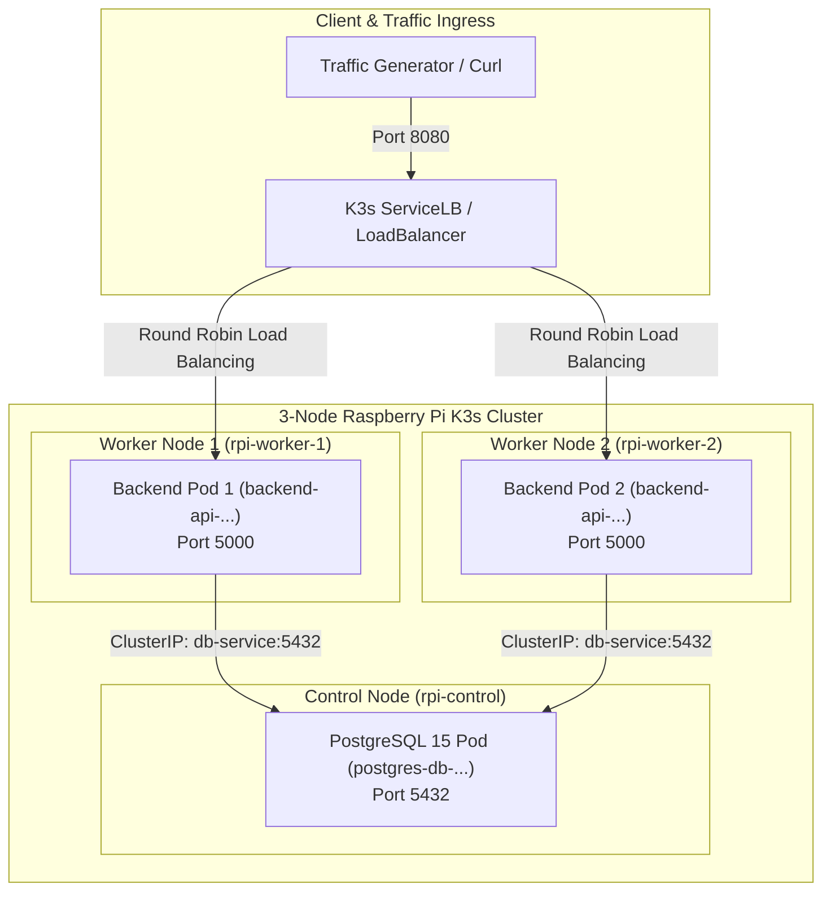

# 2-Tier Self-Healing Application on Raspberry Pi K3s Cluster

A production-grade, lightweight 2-tier application (Python Flask API + PostgreSQL 15 Alpine) purpose-built for experimenting with **Kubernetes network self-healing**, **exponential backoff reconnection**, **Liveness & Readiness probe isolation**, and **multi-node workload distribution** on a 3-node Raspberry Pi K3s cluster.

---

## 1. System Architecture



### Self-Healing & Network Resilience Highlights
1. **Exponential Backoff Reconnection**: Transient network hiccups or DB restarts do not crash the Flask API. Connections retry up to 5 times ($1\text{s} \to 2\text{s} \to 4\text{s} \to 8\text{s} \to 16\text{s}$) with detailed `[NET-WARN]` alerts in stdout.
2. **Probe Decoupling (Liveness vs. Readiness)**:
   - **Liveness Probe (`/healthz`)**: Only checks if the WSGI server process is alive. External DB failure **never** trips the liveness probe, preventing catastrophic restart cascades.
   - **Readiness Probe (`/ready`)**: Performs a rapid `SELECT 1;` check. If the network between a pod and the database degrades, the pod drops from `1/1` to `0/1 Ready`, immediately instructing `kube-proxy` / `ServiceLB` to halt routing incoming user traffic to the degraded pod.
3. **K8s Downward API**: Dynamically exposes `HOSTNAME` (Pod name) and `NODE_NAME` (underlying Raspberry Pi host) in HTTP responses for visual proof of load balancing and node anti-affinity distribution.

---

## 2. Project File Structure

| File | Purpose |
| :--- | :--- |
| [`app.py`](app.py) | Resilient Flask API, exponential backoff DB connection logic, counter updates, and probe endpoints. |
| [`requirements.txt`](requirements.txt) | Pinned lightweight dependencies (`flask`, `psycopg2-binary`, `gunicorn`). |
| [`Dockerfile`](Dockerfile) | Multi-arch ARM64/AMD64 `python:3.11-slim` image, non-root user, optimized layer caching. |
| [`k8s-manifests.yaml`](k8s-manifests.yaml) | Full K8s bundle: Secret, Database Deployment & ClusterIP Service, Backend Deployment (anti-affinity & Downward API) & LoadBalancer Service. |
| [`test-traffic.sh`](test-traffic.sh) | Visual traffic generator displaying round-robin routing between pods and nodes. |
| [`chaos-test.sh`](chaos-test.sh) | Automated chaos scenarios (DB pod kill, network blackhole, worker node drain). |
| [`docker-compose.yml`](docker-compose.yml) | Local offline testing stack prior to cluster deployment. |

---

## 3. Quick Start & Deployment Guide

### Prerequisites
- 3-node Raspberry Pi cluster running K3s (1 control-plane, 2 worker nodes).
- Docker or `nerdctl` installed to build images, or build directly with K3s containerd.

### Step 1: Build the Container Image for ARM64
On your build machine or directly on one of your Raspberry Pis:

```bash
# Build the image locally
docker build -t backend-api:latest .
```

If using K3s without a private container registry, import the image directly into K3s's `containerd` runtime on each node:

```bash
# Export and import into containerd
docker save backend-api:latest | sudo k3s ctr images import -
```

*(Alternatively, tag and push to your local Docker registry or GitHub Container Registry: `docker tag backend-api:latest <your-registry>/backend-api:latest` and update the image path in `k8s-manifests.yaml`)*.

### Step 2: Deploy to K3s Cluster
Run the following from your control node:

```bash
kubectl apply -f k8s-manifests.yaml
```

Verify resource creation:

```bash
kubectl get pods -o wide
kubectl get svc -o wide
```

Expected output showing node distribution:
```text
NAME                            READY   STATUS    IP           NODE
postgres-db-7d8b5894b8-x789l   1/1     Running   10.42.0.12   rpi-control
backend-api-5c94c4897f-4a1b2    1/1     Running   10.42.1.25   rpi-worker-1
backend-api-5c94c4897f-8c3d4    1/1     Running   10.42.2.30   rpi-worker-2
```

---

## 4. Validating Node Distribution & Load Balancing

Execute the traffic test script against the LoadBalancer port (`8080`):

```bash
chmod +x test-traffic.sh chaos-test.sh
./test-traffic.sh http://<RPI_NODE_IP>:8080/ 10
```

Sample output confirming round-robin across distinct worker nodes and pods:
```text
REQ#   | STATUS       | POD NAME                     | NODE NAME        | DB VISITS  | LATENCY   
--------------------------------------------------------------------------------------------------
1      | HTTP 200     | backend-api-5c94c4897f-4a1b2 | rpi-worker-1     | 1          | 4.21ms    
2      | HTTP 200     | backend-api-5c94c4897f-8c3d4 | rpi-worker-2     | 2          | 3.85ms    
3      | HTTP 200     | backend-api-5c94c4897f-4a1b2 | rpi-worker-1     | 3          | 3.12ms    
4      | HTTP 200     | backend-api-5c94c4897f-8c3d4 | rpi-worker-2     | 4          | 3.44ms    
```

---

## 5. Network Self-Healing & Fault Tolerance Experiments

Run `./chaos-test.sh` or execute each experiment manually:

### Experiment 1: Database Pod Kill & Connection Recovery
Simulate an abrupt database process failure:
```bash
kubectl delete pod -l app=postgres-db --now
```
1. In `kubectl logs -l app=backend-api -f`, notice the warnings:
   ```text
   [NET-WARN] Database connection failed (attempt 1/5): could not connect to server... Retrying in 1.0s...
   ```
2. Kubernetes detects the terminated pod and instantly launches a replacement.
3. As soon as Postgres is ready, the next retry succeeds without returning an error to the user!

### Experiment 2: Readiness Isolation (Network Partitioning)
Scale down Postgres to 0 replicas to simulate a broken internal database network:
```bash
kubectl scale deployment postgres-db --replicas=0
```
- Within $6\text{s}$ ($2 \times \text{periodSeconds}$), both `backend-api` pods fail their `/ready` probe and drop to `0/1 Ready`.
- `kubectl get endpoints backend-service` shows `ENDPOINTS: <none>`.
- Client requests receive immediate fast failure instead of hanging indefinitely.
- Scale back up: `kubectl scale deployment postgres-db --replicas=1`. Within seconds, pods transition back to `1/1 Ready` and resume serving traffic smoothly.

### Experiment 3: Worker Node Outage (Drain / Eviction)
Drain one of your Raspberry Pi worker nodes:
```bash
kubectl drain rpi-worker-1 --ignore-daemonsets --delete-emptydir-data --force
```
- Kubernetes detects the cordon/drain and reschedules the pod to another available node while the application continues serving traffic uninterrupted.

